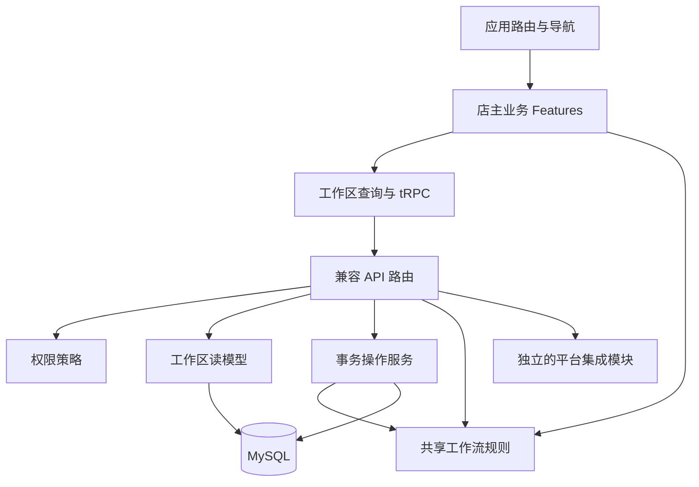

# V2 架构：以店主工作流组织模块

## 目标与边界

把“打开模块、理解字段、寻找下一页”改成“打开待办、看下一步、带着上下文完成操作”。采用模块化单体，而非在没有部署需求时拆微服务；保留 React / Hono / tRPC / Drizzle / MySQL 技术栈和现有数据表。

本版是 `2.0.0-alpha.1`。原版基线为 `3bcde3f`，通过独立分支和 PR 管理，不直接合并或覆盖 `main`。

## 目录职责

```text
app/
  src/
    app/                       应用路由、导航、页面级懒加载、404
    features/
      overview/                今日经营、任务入口、订单期限排序
      orders/                  工作队列、手工录入、商品匹配、库存重查
      fulfillment/             打包交运与售后；独立路由，共享履约上下文
      catalog/                 商品、平台映射、可售与在途、补货入口
      purchasing/              采购、付款事实、收货质检
      sourcing/                选品、供应商、渠道适售决策
      finance/                 贡献利润、费用、汇率、到账核对
      settings/                店铺连接、成员、同步任务、审计
      auth/                    登录
    components/                共享布局、基础 UI 与工作台展示组件
    hooks/                     共享认证与工作区查询
    providers/                 tRPC / React Query、主题
    lib/                       展示格式与基础工具
  contracts/
    merchant-workflow.ts        无 I/O 的工作队列、分配与在途业务规则
  api/
    router.ts                  保持兼容的 API 组合根
    modules/workbench/
      router.ts                输入校验、权限调用、事务编排、兼容端点
      read-model.ts            工作区读模型、关联数据、财务字段投影
      operations.ts            库存约束、订单分配、任务去重、审计与采购状态
      permissions.ts           角色与业务区域权限策略
      numbers.ts               共享金额转换与舍入
    integrations/              平台 OAuth 与店铺概况读取
    queries/                   数据库连接及用户查询
  db/                          Schema、迁移、显式数据库清理工具
```

组件尽量留在拥有该业务的 feature 中；只有跨业务的展示组件进入 `components/`。Feature 不直接查询数据库，也不导入其他 feature 的页面。跨页面链接传递业务 ID，不传递可信库存或金额。前端类型由 tRPC 契约推导，不另维护一套接口定义。



## 店主操作链路

| 场景 | 入口与上下文 | 完成后的事实 |
| --- | --- | --- |
| 今日经营 | 订单金额、已核实贡献利润、待办队列 | 统计按悉尼下单日期计算，AUD 不与其他币种混加 |
| 处理订单 | `queue` / `q` / `focus` 存在 URL 中 | 缺货、未付款与已结束订单不会进入正常待发货队列 |
| 匹配订单商品 | 订单内选择名称 / 规格，不输入 SKU ID | 只允许补齐尚未绑定的订单行，不改写既有商品快照 |
| 缺货补货 | 库存页进入采购，携带 `sku` 与缺口数量 | 在途只统计已下单且未收、未关闭的数量，不视作可售 |
| 收货 | 选择采购单与明细，预填未收数量 | 合格、残次、待检分别核对；默认不推定商品已合格 |
| 重新分配 | 缺货订单点击“重新检查库存” | 在服务端事务内重新检查，部分已发订单保留累计分配数量 |
| 打包发货 | `order` 带入订单与剩余可发商品 | 扣除其他草稿包裹数量，可按行分包；保存草稿不扣实物 |
| 实际交运 | 带包裹编号的确认对话框 | 实际扣库与平台核对独立，平台失败不撤销已交运事实 |
| 售后 | `/after-sales?order=...` 或 `focus` 定位事件 | 退款、退货与结案独立选择，入库需明确选择且防止重复 |

部分发货订单可同时出现在“待发货”和“已发货”队列：前者是剩余工作，后者是发货历史，不是互斥的数据库状态。已付款但缺货的订单优先补货；实际入库后，由店主在订单中明确发起库存重查，本版不运行后台自动分配任务。

## 不可破坏的业务约束

1. 可售 = 合格在库 − 已预留；实物 = 合格 + 不可售，不以负库存隐藏缺货。
2. 付款记录不代表真实支付，采购下单不代表收货，草稿包裹不代表交运。
3. 平台状态、内部履约、付款、售后仍分开保存，界面“下一步”只是派生视图。
4. 已有 API 路径和数据表不变，服务端权限仍为最终授权边界。新增 `workbench.resolveOrderLines` 用于补齐未匹配商品与显式库存重查。
5. 库存变化、人工核对和商品匹配保留来源、审计与幂等约束。跨订单库存分配使用库存行锁；新增包裹在订单锁下检查草稿占用。
6. 结案不会自动改成已退款或合格退货；重新入库需合格事实、原订单商品、合理数量和唯一事件记录。
7. 无平台数据、无财务权限或无已核实利润时明确说明，不生成演示数字。订单金额、贡献利润与银行到账不是同一口径。

## 兼容与部署

- 不需要新增数据库迁移；不自动执行 `db:reset`、`db:push` 或任何生产数据操作。
- 旧路径 `/orders`、`/inventory`、`/procurement` 等保持可用；`/shipping` 现在只呈现发货，售后改为 `/after-sales`。
- `workbench.workspace` 与旧 `workbench.dashboard` 保留，既有 API 消费方不必立即迁移。
- 生产切换应先备份数据库，在独立数据库验证原版历史订单、部分发货、缺货补货、退款和退货入库，再切换部署版本。
- 分支隔离不等于数据库隔离。原版与新版若连接同一个库，会读写同一份事实；不建议这样做评审。
- 紧急回退代码可重新部署原版基线，但**代码回退不会撤销新版已经记录的业务事实**。不得把还原数据库当成日常回滚动作。

## 验证

在 `app/` 中执行：

```text
npm run check
npm test
npm run build
npm run lint
```

测试覆盖共享队列 / 数量 / 在途 / 日期规则、角色权限兼容，以及使用合成数据渲染页面的上下文接线。页面渲染测试不是浏览器点击端到端测试，也不替代 MySQL 并发与真实平台联调。全量 lint 当前包含原版 UI / HTTP 工具中的既有错误，不应通过关闭规则掩盖。

## 后续演进边界

本版已经抽出读模型、事务服务和权限策略，但 API 仍保留兼容路由作为命令编排层。后续按已验证的业务边界进一步拆分命令处理器，不为每个表机械创建 Service / Repository。

优先补上真实数据库事务与并发测试，再考虑分页读模型和按域查询，避免整站长期依赖一次全量工作区快照。订单自动同步、后台自动分配、物流面单购买、平台发货写回和实际退款执行均需独立验证与授权，不属于本版新增能力。
